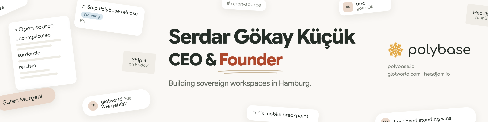

  <a href="https://polybase.io"><b>polybase.io</b></a> &nbsp;·&nbsp;
  <a href="https://glotworld.com"><b>glotworld.com</b></a> &nbsp;·&nbsp;
  <a href="https://headjam.io"><b>headjam.io</b></a> &nbsp;·&nbsp;
  <a href="https://gokaykucuk.com"><b>gokaykucuk.com</b></a>

I build [Polybase](https://polybase.io), a sovereign workspace for teams, from Hamburg. On the side I make games and small open-source tools, mostly in Go, Rust, TypeScript and Python.

## What I'm working on

| | Project | What it is |
| --- | --- | --- |
| 🏢 | **[Polybase](https://polybase.io)**   CEO & Founder | Sovereign, agentic workspace: team chat, tasks, documents, files, meetings, calendars, tables, automation and AI in one place. Runs on an EU cloud, in your own cloud account or on your own servers. |
| 🗺️ | **[glotworld](https://glotworld.com)**   Side project | A story RPG in the browser for learning German. Walk a town where everyone speaks German, talk to people and pick up the words you need. |
| 🎮 | **[Headjam](https://headjam.io)**   A Papricode product | A multiplayer browser game where your webcam is the controller. Move your head to keep the ball bouncing; last head standing wins. |

## Open source

### Featured

| Project | Stack | What it does |
| --- | --- | --- |
| [uncomplicated](https://github.com/gokaykucuk/uncomplicated) | Rust | Fast static analysis for JavaScript, TypeScript and Go, built for CI. SonarQube's rules and quality gate as one native binary: no server, no JVM, no Node.js. |
| [surdantic](https://github.com/gokaykucuk/surdantic) | Python | A Pydantic-first web framework for SurrealDB: REST APIs, SSE subscriptions, auth and background workers generated from your models. |
| [realism](https://github.com/gokaykucuk/realism) | TypeScript | A PocketBase-inspired backend framework on Bun, ElysiaJS and SurrealDB. Alpha. |
| [iptvbro](https://github.com/gokaykucuk/iptvbro) | TypeScript | An open-source IPTV browser and viewer. Load any M3U playlist. |
| [remotesh](https://github.com/gokaykucuk/remotesh) | Go | Simple remote desktop, but for the terminal. |
| [splittt](https://github.com/gokaykucuk/splittt) | Rust | 🪓 A rusty PDF splitter. |
| [forget_that](https://github.com/vehiculum-berlin/forget_that) | Ruby | A simple library that makes data anonymization easier. |
| [elevator](https://github.com/gokaykucuk/elevator) | Go | Request and switch to superuser with one line. |

<b>Everything else</b>

 

| Project | Stack | What it does |
| --- | --- | --- |
| [quotecommit](https://github.com/gokaykucuk/quotecommit) | Go | A horrible tool that lets you become unnecessarily lazy. |
| [ipfs-buildpack](https://github.com/gokaykucuk/ipfs-buildpack) | Shell | An IPFS client buildpack for Dokku and Heroku apps. |
| [bluedruid](https://github.com/gokaykucuk/bluedruid) | TypeScript | A simpler approach to FaunaDB. |
| [specimen02](https://github.com/gokaykucuk/specimen02) | TypeScript | A very simple Node.js library for building command-line tools. |
| [overtime](https://github.com/gokaykucuk/overtime) | Jupyter | An overtime calculator based on git commit timestamps. |
| [rey](https://github.com/gokaykucuk/rey) | Rust | Decentralized, fast and transparent vote counting. |
| [valut_cleaner](https://github.com/gokaykucuk/valut_cleaner) | Python | A script for cleaning up password managers. |
| [raspberry-file-server](https://github.com/gokaykucuk/raspberry-file-server) | Shell | Turn a Raspberry Pi Debian install into a headless file server. |
| [butlerbox](https://github.com/gokaykucuk/butlerbox) | Ruby | A simple IMAP email checker for the Raspberry Pi. |
| [kanarya](https://github.com/gokaykucuk/kanarya) | PHP | Easy to install, self-hosted music streaming. |
| [ondansonrafm](https://github.com/gokaykucuk/ondansonrafm) | PHP | A web radio I made way back, with a board to post on. |
| [wikistory](https://github.com/gokaykucuk/wikistory) | Jupyter | Experiments on Wikipedia dump history. |
| [blog](https://github.com/gokaykucuk/blog) | Hugo | My personal blog. |
| [dotfiles](https://github.com/gokaykucuk/dotfiles) | Shell | My dotfiles. |

## Get in touch

🌐 [gokaykucuk.com](https://gokaykucuk.com) · 🏢 [polybase.io](https://polybase.io) · 🗺️ [glotworld.com](https://glotworld.com) · 🎮 [headjam.io](https://headjam.io) · 📍 Hamburg
